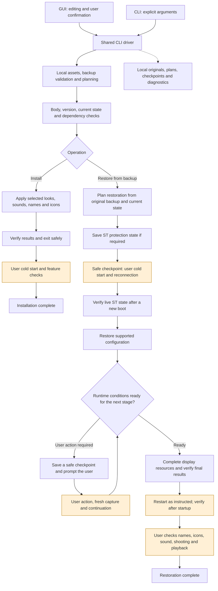

# High-level workflow · alpha.62

English | [简体中文](architecture_zh.md)

This diagram describes tool stages, checks and user actions, without concrete device addresses or implementation locations.



Yellow nodes require user action. ST protection and other checkpoints depend on live conditions; the number of restarts is not fixed. A checkpoint is a safe continuation point, not completion.

## Installation pseudocode

```text
install(final_selection, original_backup):
    bind_final_controls_and_exact_assets()
    plan_locally()
    verify_supported_body_version_and_required_dependencies()
    verify_current_baseline_and_workspace_budget()
    retain_required_original_materials()
    apply_selected_configuration()
    verify_each_result_and_final_state()
    clean_owned_temporary_files_and_exit_safely()
    wait_for_user_cold_start_and_feature_checks()
    mark_installation_complete()
```

## Restoration pseudocode

```text
restore(original_backup, optional_checkpoint):
    current = capture_fresh_current_state()
    plan = compare_supported_scope(current, original_backup)
    verify_identity_dependencies_and_checkpoint_if_present()

    if ST_protection_is_required:
        save_current_look_and_all_custom_base_looks_as_ST()
        save_safe_checkpoint_and_exit()
        wait_for_fresh_boot_and_current_capture()
        verify_actual_live_ST_state()

    restore_supported_configuration(plan)
    for each_remaining_stage:
        check_current_runtime_conditions()
        if a_user_startup_boundary_is_required:
            save_safe_checkpoint_and_exit()
            wait_for_user_operation_and_fresh_capture()
            rebuild_remaining_plan()
        complete_supported_stage()

    verify_final_results_and_exit_safely()
    verify_fresh_post_startup_state()
    wait_for_user_names_sound_shooting_and_playback_checks()
    validate_retained_evidence_and_mark_complete()
```

Restoration uses the selected original backup and current state, without relying on installation order. It covers the tool's supported features and required related items, retaining unrelated current data.
