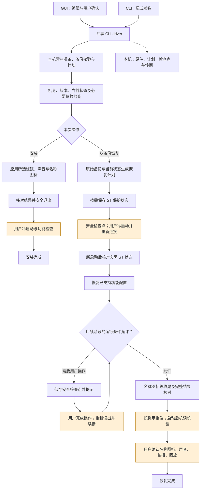

# 高层使用流程 · alpha.62

[English](architecture.md) | 简体中文

本图描述工具的阶段、检查与用户操作，不列具体设备地址或实现点位。



黄色节点需要用户操作。ST 保护及其他节点按现场需要安排，不承诺固定重启次数。检查点是安全续接位置，不是任务完成。

## 安装伪代码

```text
install(final_selection, original_backup):
    bind_final_controls_and_exact_assets()
    plan_locally()
    verify_supported_body_version_and_required_dependencies()
    verify_current_baseline_and_workspace_budget()
    retain_required_original_materials()
    apply_selected_configuration()
    verify_each_result_and_final_state()
    clean_owned_temporary_files_and_exit_safely()
    wait_for_user_cold_start_and_feature_checks()
    mark_installation_complete()
```

## 从备份恢复伪代码

```text
restore(original_backup, optional_checkpoint):
    current = capture_fresh_current_state()
    plan = compare_supported_scope(current, original_backup)
    verify_identity_dependencies_and_checkpoint_if_present()

    if ST_protection_is_required:
        save_current_look_and_all_custom_base_looks_as_ST()
        save_safe_checkpoint_and_exit()
        wait_for_fresh_boot_and_current_capture()
        verify_actual_live_ST_state()

    restore_supported_configuration(plan)
    for each_remaining_stage:
        check_current_runtime_conditions()
        if a_user_startup_boundary_is_required:
            save_safe_checkpoint_and_exit()
            wait_for_user_operation_and_fresh_capture()
            rebuild_remaining_plan()
        complete_supported_stage()

    verify_final_results_and_exit_safely()
    verify_fresh_post_startup_state()
    wait_for_user_names_sound_shooting_and_playback_checks()
    validate_retained_evidence_and_mark_complete()
```

恢复依据是所选原始备份与当前状态，不依赖先前安装顺序。恢复范围为工具支持的功能及必要关联项，无关当前数据保持原样。
